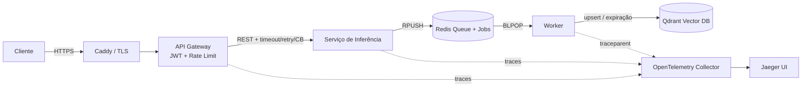

# Plataforma de IA como Serviço — C3.A2

**Disciplina:** Sistemas Distribuídos e Computação em Nuvem  
**Instituição:** FAESA · 2026/2  
**Trabalho:** C3.A2 — Plataforma de IA como Serviço  
**Professor:** M.Sc. Howard Cruz Roatti

> Implementação própria baseada no kit oficial `howardroatti/sd-2026-2-kit-c3a2`. O kit foi usado como referência de estrutura e requisitos; os serviços, a integração, as políticas de segurança, a resiliência e a observabilidade foram implementados para este projeto.

## 1. Visão geral

A aplicação recebe textos por uma API protegida, transforma cada solicitação em uma tarefa assíncrona, processa a tarefa em um worker e persiste uma representação vetorial no Qdrant. O processamento é intencionalmente simples: o objetivo da disciplina é demonstrar engenharia distribuída, não treinar ou comparar modelos de aprendizado de máquina.

### Arquitetura



### Serviços

| Serviço | Responsabilidade | Porta interna |
|---|---|---:|
| `gateway` | API pública, JWT, rate limit, roteamento, timeout, retry e circuit breaker | 8000 |
| `inferencia` | Valida a entrada, cria tarefa e publica mensagem na fila Redis | 8001 |
| `worker` | Consome tarefas, executa classificação demonstrativa e grava vetor no Qdrant | — |
| `redis` | Fila assíncrona e estado temporário das tarefas | 6379 |
| `qdrant` | Armazenamento vetorial | 6333 |
| `otel-collector` | Recebe e encaminha traces OTLP | 4317/4318 |
| `jaeger` | Interface de consulta de rastreamento distribuído | 16686 |
| `caddy` | Proxy reverso com HTTPS automático (perfil de publicação) | 80/443 |

## 2. Como executar do zero

### Pré-requisitos

- Docker Desktop ou Docker Engine com Docker Compose v2;
- Git (opcional, para clonar o repositório);
- portas locais 8000, 6333 e 16686 disponíveis.

### Inicialização

```bash
git clone https://github.com/Ianmatsukase/Plataforma-IA-C3A2.git
cd Plataforma-IA-C3A2
cp .env.example .env
```

Edite `.env` e defina, no mínimo, `JWT_SEGREDO` com um segredo aleatório de 32 caracteres ou mais e `SENHA_DEMO` com uma senha própria. Para iniciar toda a plataforma com um único comando:

```bash
docker compose up --build -d
```

Verifique os containers:

```bash
docker compose ps
docker compose logs -f gateway inferencia worker
```

A documentação interativa fica em `http://localhost:8000/docs`, o Jaeger em `http://localhost:16686` e o Qdrant em `http://localhost:6333/dashboard`.

### Fluxo de uso

1. Faça login para receber um JWT:

```bash
curl -X POST http://localhost:8000/login \
  -H 'Content-Type: application/json' \
  -d '{"usuario":"aluno","senha":"troque-esta-senha"}'
```

Use os valores configurados em `.env` (`USUARIO_DEMO` e `SENHA_DEMO`). Copie o campo `access_token` da resposta.

2. Envie uma solicitação autenticada. Substitua `SEU_TOKEN`:

```bash
curl -X POST http://localhost:8000/predict \
  -H 'Authorization: Bearer SEU_TOKEN' \
  -H 'Content-Type: application/json' \
  -d '{"texto":"O atendimento foi excelente e rápido"}'
```

A resposta é HTTP `202 Accepted` e contém `job_id`, pois o processamento é assíncrono.

3. Consulte o resultado usando o identificador retornado:

```bash
curl http://localhost:8000/jobs/SEU_JOB_ID \
  -H 'Authorization: Bearer SEU_TOKEN'
```

Enquanto o worker não terminar, o status será `queued` ou `processing`. Ao concluir, será `completed` e haverá um resultado demonstrativo de sentimento. A tarefa expira após `JOB_TTL_SEGUNDOS`.

### Teste sem autenticação

```bash
curl -i -X POST http://localhost:8000/predict \
  -H 'Content-Type: application/json' -d '{"texto":"teste"}'
```

A resposta esperada é `401 Unauthorized`.

## 3. Comunicação e processamento distribuído

- O cliente acessa somente o gateway.
- O gateway valida o JWT e aplica rate limit por usuário/minuto usando contador Redis.
- O gateway chama o serviço de inferência por REST com timeout de conexão/leitura.
- O serviço de inferência registra o estado inicial e publica a mensagem em uma fila Redis (`fila:inferencia`).
- O worker consome a fila com `BLPOP`, processa a tarefa e atualiza o estado no Redis.
- O worker cria um vetor determinístico de 64 dimensões e o persiste no Qdrant. O texto original não é gravado no payload vetorial.
- O resultado pode ser consultado pelo gateway com `GET /jobs/{job_id}`.

A comunicação entre containers usa os nomes DNS dos serviços definidos no Compose, sem IPs fixos.

## 4. Resiliência

### Timeout

A chamada gateway → inferência usa timeout de conexão de 2 segundos e timeout de resposta de 5 segundos. A conexão com Redis e Qdrant também tem limites de tempo configurados.

### Retry com backoff exponencial

O gateway realiza até três tentativas em caso de timeout, falha de conexão ou erro HTTP transitório. O intervalo entre as tentativas cresce exponencialmente (250 ms e 500 ms).

### Circuit breaker

O gateway abre o circuito após três falhas consecutivas e bloqueia novas chamadas por 15 segundos. Após o período, permite uma tentativa de recuperação (half-open); em caso de sucesso, fecha o circuito.

### Falhas do worker

Falhas durante o processamento marcam a tarefa como `failed`, sem expor detalhes internos ao cliente. O worker permanece ativo para continuar consumindo as próximas mensagens. Em produção, uma fila de dead-letter e uma política de reprocessamento poderiam ser adicionadas para maior garantia de entrega.

## 5. Observabilidade e rastreamento distribuído

Os serviços instrumentam spans com OpenTelemetry e exportam traces via OTLP para o Collector. O contexto W3C `traceparent` é propagado no caminho gateway → inferência → mensagem Redis → worker. O Collector encaminha os traces ao Jaeger.

Para visualizar:

1. Abra `http://localhost:16686`;
2. Selecione o serviço `gateway`, `inferencia` ou `worker`;
3. Execute uma chamada autenticada e atualize a busca;
4. Abra um trace e confira os spans correspondentes ao envio e processamento da tarefa.

Os logs registram rota, status e duração, sem imprimir o corpo da requisição, JWT ou senha.

## 6. Segurança

- JWT assinado com HS256 e validade configurável; as rotas de submissão e consulta exigem `Authorization: Bearer`.
- Rate limit por usuário e janela de um minuto, com limite configurável.
- Segredos e parâmetros são lidos de variáveis de ambiente; `.env` não deve ser enviado ao Git.
- Os serviços internos não precisam ser expostos publicamente. Em implantação, exponha apenas Caddy/gateway.
- HTTPS em produção é terminado no Caddy, que solicita e renova certificados TLS automaticamente. O domínio deve apontar para o IP público da máquina e as portas 80/443 devem estar liberadas.
- A credencial de demonstração deve ser substituída antes da publicação. O endpoint `/login` é didático; para uso real, as senhas devem ser armazenadas com hash forte e a identidade deve vir de um provedor apropriado.

## 7. LGPD — dados tratados, finalidade e retenção

| Dado | Finalidade | Retenção prevista |
|---|---|---|
| Nome de usuário configurado | Autenticar e associar a solicitação ao usuário | Enquanto a tarefa existir; até `JOB_TTL_SEGUNDOS` (padrão: 1 hora) |
| Senha de demonstração | Validar login | Mantida como variável de ambiente; não é registrada em logs nem persistida pela aplicação |
| JWT | Autorizar chamadas | Até expirar (`JWT_EXPIRACAO_MINUTOS`, padrão: 60 min); não é armazenado pelo gateway |
| Texto enviado | Executar a classificação e gerar vetor | Transitório na fila e na memória durante o processamento; não é incluído no payload do Qdrant nem nos logs |
| Resultado da classificação e estado da tarefa | Permitir consulta do processamento | Até `JOB_TTL_SEGUNDOS` (padrão: 1 hora) no Redis |
| Vetor e metadados técnicos (`job_id`, sentimento, horário) | Persistência vetorial demonstrativa | Até `VECTOR_TTL_SEGUNDOS` (padrão: 24 horas); o worker remove vetores expirados periodicamente |
| Logs técnicos (rota, status, duração) | Diagnóstico e observabilidade | Retenção do runtime/ambiente de hospedagem; não incluem texto, senha ou token |

O sistema é uma demonstração acadêmica. Não envie dados pessoais reais ou sensíveis. Em um cenário de produção, a organização deve definir base legal, aviso de privacidade, controle de acesso administrativo, retenção formal, backup e processo para atender solicitações dos titulares.

## 8. Relatório curto de trade-offs

### CAP

A plataforma prioriza disponibilidade e tolerância a partições em componentes distribuídos, aceitando consistência eventual no fluxo assíncrono. Depois de receber HTTP 202, o resultado ainda pode estar `queued` ou `processing`; o cliente consulta posteriormente. Redis e Qdrant são dependências separadas, então uma falha temporária pode atrasar ou impedir o processamento. O gateway falha de forma controlada quando não consegue acessar a fila/serviço, em vez de confirmar uma tarefa não persistida.

### Custo

O ambiente local usa imagens open-source e execução em containers, sem custo de licença. Em nuvem, o custo depende da máquina/instância, armazenamento persistente, tráfego, domínio e disponibilidade do plano gratuito. Free tiers podem dormir, limitar CPU/memória ou mudar suas condições; por isso, o deploy deve ser validado no provedor escolhido. Qdrant e Redis gerenciados simplificam operação, mas podem gerar custo adicional.

### Latência

O envio da tarefa é rápido porque o gateway não espera a inferência terminar (HTTP 202). O tempo total inclui fila, inicialização/consumo do worker e gravação no Qdrant. A separação aumenta a latência total em relação a uma chamada síncrona simples, mas melhora desacoplamento e absorção de picos. Retry e timeout reduzem espera ilimitada, mas retries também podem aumentar a latência em falhas.

## 9. Deploy público e HTTPS

**Provedor:** Railway  
**URL pública:** https://plataforma-ia-c3a2-production.up.railway.app  
**Data do último teste público:** 26/11/2026  
**Protocolo:** HTTPS

O serviço Gateway foi publicado no Railway com domínio público e HTTPS. O fluxo de autenticação JWT, envio de solicitações e processamento assíncrono foi testado com sucesso.

Serviços utilizados na implantação:
- Gateway: API pública.
- Inferência: processamento e encaminhamento das tarefas.
- Redis: fila e estado das tarefas.
- Worker: execução do processamento assíncrono.
- Qdrant: serviço de armazenamento vetorial.

A observabilidade com OpenTelemetry e Jaeger está configurada para validação no ambiente local por meio do Docker Compose.


## 10. Testes locais

Os testes unitários do processamento podem ser executados no ambiente Python com as dependências do worker:

```bash
python -m pip install -r worker/requirements.txt
python -m unittest discover -s tests -v
```

Verificação sintática dos serviços:

```bash
python -m compileall gateway inferencia worker tests
```

## 11. Checklist antes de entregar

- [ ] `docker compose up --build -d` inicia todos os serviços;
- [ ] `/saude` responde pelo gateway;
- [ ] `/predict` sem JWT retorna 401;
- [ ] login retorna token válido;
- [ ] `POST /predict` retorna 202 e um `job_id`;
- [ ] `GET /jobs/{job_id}` chega a `completed`;
- [ ] vetor aparece na coleção Qdrant `solicitacoes`;
- [ ] traces aparecem no Jaeger cobrindo gateway, inferência e worker;
- [ ] HTTPS funciona na URL pública;
- [ ] URL pública e data do teste foram preenchidas neste README;
- [ ] `.env` e segredos não foram enviados ao GitHub.

## Licença

Consulte `LICENSE`.
